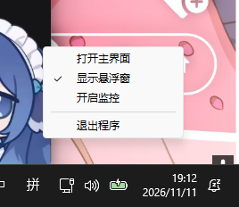
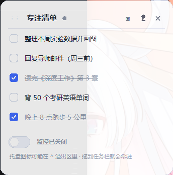
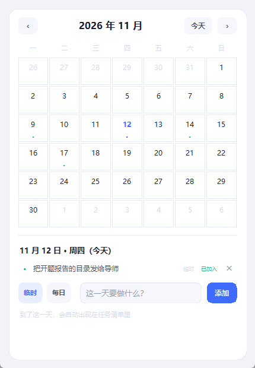
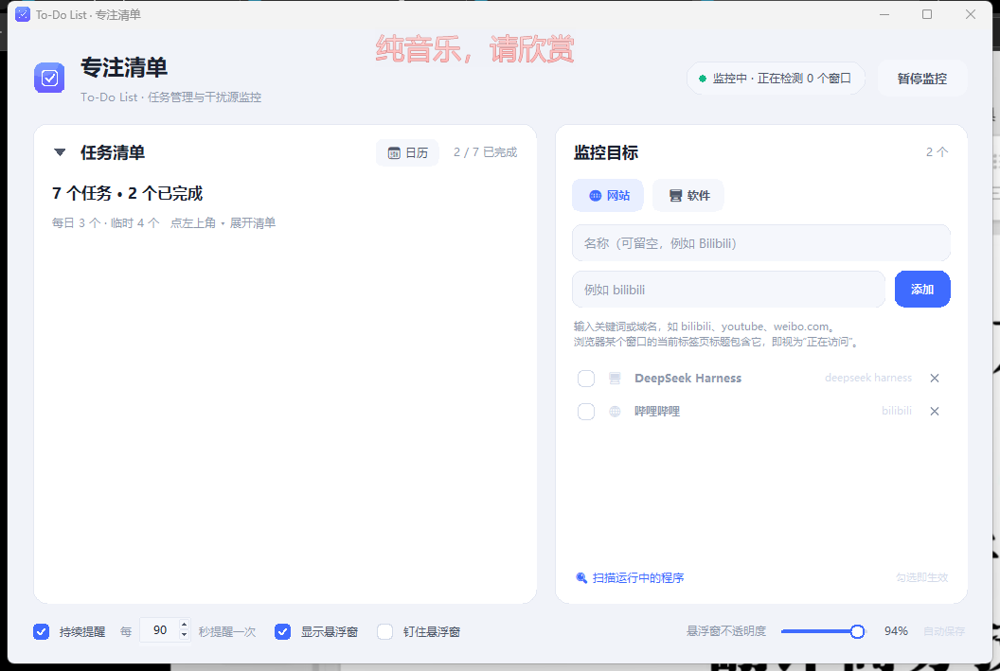
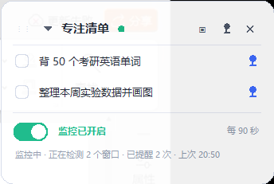
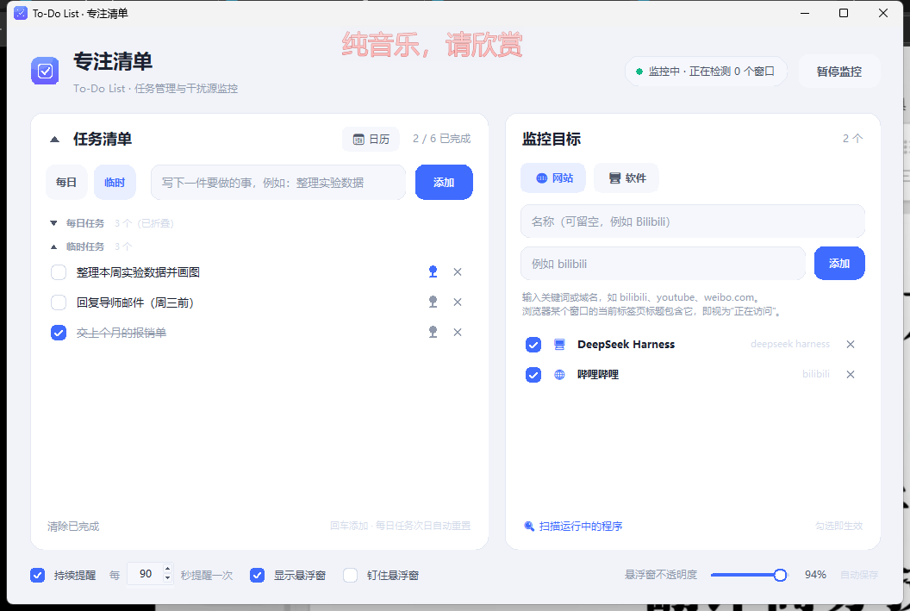
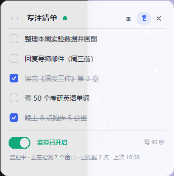

# To-Do List · 专注清单

[](https://github.com/2756983619-collab/to-do-list/actions/workflows/tests.yml)
[](LICENSE)
[](https://www.python.org/)
[](#)

一个支持 Windows 和 macOS 的桌面小工具：左边管理今天的任务（分成"每日"和"临时"两类，带月历安排），右边盯住那些一打开就会让你分心的网站和软件。
开着监控时，一旦检测到你打开了它们，就会弹窗提醒你"回到工作"。

界面是白色圆角风格（卡片、输入框、按钮、勾选框都是圆角），主窗口负责编辑，另有一个像音乐播放器歌词窗口一样的置顶悬浮窗；提醒弹窗带半透明毛玻璃感。


## 直接使用

不想碰代码的话，去仓库的 **Releases** 页面下载打包好的文件，两种版本功能完全一样：

| 版本 | 下载文件 | 适合 |
| --- | --- | --- |
| **安装包**（推荐自己用） | `ToDoList-Setup-x.y.z.exe` | 双击安装，有开始菜单 / 桌面图标，可在"应用和功能"里卸载；装到 `%LOCALAPPDATA%\ToDoList`，不需要管理员权限 |
| **便携版** | `ToDoList-portable-x.y.z.zip` | 解压到一个文件夹里双击就用，不写注册表；放 U 盘里可以带走 |

仓库里**只放源码**，exe 打包产物走 Releases（体积原因，见 `.gitignore`）。想自己构建见下面的「重新打包」。

数据存放规则（两个版本一致，**装在哪个盘就存在哪个盘**）：

- 默认存在 **程序目录下的 `data\todo.json`**：装到哪就存哪，不占 C 盘额外空间。
- 万一程序目录不可写（比如手动解压进 Program Files 又没有权限），程序会自动退到 `%LOCALAPPDATA%\ToDoList` → 临时目录，不会悄悄丢数据。
- 托盘日志 `tray.log` 也在同一个 `data\` 目录里。
- macOS 除外：数据在 `~/Library/Application Support/ToDoList/todo.json`。

首次启动新版时，如果发现旧版把数据留在了 `%APPDATA%\ToDoList` 或 exe 旁边，会自动把**最新的一份**复制到新位置，任务不会丢。

## 功能说明

### 1. 任务清单

- 在输入框写下一件事，按 **回车** 或点 **添加**。框里的灰色提示文字点进去就会消失，离开输入框又会回来。
- 添加前先选 **每日** 或 **临时**：
  - **每日任务**：每天都会出现。今天勾掉，第二天早上自动变回未勾选。
  - **临时任务**：一次性的。当天勾掉，第二天自动从清单里消失；没勾的会一直留着。
- 列表按这两类分组显示，标题后面带条数。
- 点左侧方框 **勾选完成**：文字会划掉、变灰，但**不会消失**，方便回看今天做了什么。
- 点任务文字可以直接**改**；清空文字后按回车（或点到别处）等于删除这一条。
- 每行右侧的 **✕** 删除单条，旁边的**图钉**把这条钉在悬浮窗上（见第 5 节）；左下角 **清除已完成** 一次性清掉所有划线任务。
- 顶部计数显示"已完成 / 总数"。
- 点标题左边的 **▲ / ▼** 可以把整个清单折起来，只剩一行摘要（"7 个任务 · 2 个已完成"）；折叠状态会记住。
- "每日任务""临时任务"两个**分组标题左侧各有一个 ▲ / ▼**，可以分别收起其中一组，另一组照常显示（标题后面会标"（已折叠）"）。

### 2. 日历

点任务卡右上角的 **📅 日历** 打开月历（窗口会停在主界面正中间）。

- 点任意一天选中它，下面列出这一天安排的事；用 `‹` `›` 翻月，**今天** 一键回到当月。
- 今天的日期是蓝色粗体；有安排的日子下面会有小圆点。
- 在下面输入框写内容、选 **临时 / 每日**，点 **添加**，就记在那一天。
- 到了那一天（程序开着或第二天启动），这件事会**自动变成任务清单里的任务**，并标记"已加入"，不会重复加。
- 补记过期的事也会被拉进来——昨天忘了写的，今天打开程序就会出现在清单里。


### 3. 监控目标

分两类，右侧切换：

| 类型 | 判定方式 | 例子 |
| --- | --- | --- |
| 网站 | 浏览器（Chrome / Edge / Firefox / Brave / Opera / 360 / QQ …）有**非最小化**窗口，且窗口标题包含关键词 | `bilibili`、`youtube`、`weibo.com`、`明日方舟` |
| 软件 | 进程名匹配，或窗口标题包含关键词 | `steam`、`msedge`、`游戏名` |

- 名称随便写（只是显示用），关键词填能唯一命中的片段即可。
- 输入框右边点 **扫描运行中的程序 / 选择网站**，可以从当前正在运行的进程、或者浏览器当前打开的标签页里直接挑一个，自动填好关键词。
- 每行前的方框可以临时**停用**某个目标，不用删掉。

### 4. 专注提醒

- 右上角 **开始监控** 后开始检测，状态栏会显示"监控中 · 正在检测 N 个窗口"。
- 一旦某个目标被打开，屏幕上方弹出提醒窗：写着是哪个目标、命中的是什么（程序名 / 窗口标题）。
- 提醒窗上的两个按钮：
  - **暂停监控 10 分钟**：临时闭嘴，适合"我现在就是要看十分钟视频"。
  - **马上专注**：关掉提醒，继续监控。
- 底部可以设置 **持续提醒** 与间隔（默认每 90 秒重复一次），也可以关掉，只在刚打开时提醒一次。
- 提醒窗是**半透明**的圆角卡片（不遮挡也能看清后面的内容），22 秒后自动消失，不会一直挡着屏幕。

### 5. 悬浮窗

类似歌词窗口的小条：白色圆角卡片、**半透明**、置顶、可以拖到屏幕任意角落。

- 显示**全部任务**，可以直接在悬浮窗里勾选完成。
- 每行右侧有**图钉**：点一下变蓝表示"钉住"，这条会一直显示在悬浮窗里；再点一下取消。
- 头部 `▲ / ▼` 折叠悬浮窗时，**只保留钉住的那几条**（其余收起），没有钉住任务时整块列表收起、只剩标题和监控开关。
- 底部有**监控开关**，不开主界面也能开关监控。
- `▣` 打开主界面，`✕` 隐藏悬浮窗，右键还有菜单（打开主界面 / 隐藏 / 钉住 / 退出）。
- **钉住悬浮窗（头部那个图钉）**：点一下钉子变蓝，悬浮窗就固定在最前面——每秒会重新抬到顶层，连别的置顶窗口也压得住；同时**不能再拖动**（鼠标变回箭头，拖动失效）。再点一下解锁。钉住状态会记住，主界面底部也做了一个 **钉住悬浮窗** 勾选框。注意它和任务行上的图钉是两件事：头部管"窗口"，行上管"这一条任务折叠时还留不留"。
- 主界面底部可以随时勾回 **显示悬浮窗**，还能拖动 **悬浮窗不透明度** 滑块（40%–100%，默认 **90%**，滑杆右侧实时显示百分比）。
- 悬浮窗和主窗口共用同一份数据，改动实时同步。

### 6. 托盘图标（Windows）

程序运行期间，右下角通知区域会有一个图标（跟微信、Steam 一样），主界面关掉以后靠它把窗口叫回来。

- **左键单击**：打开主界面。
- **右键**：弹出菜单——打开主界面 / 显示悬浮窗（可勾选）/ 开启监控（可勾选）/ 退出程序。
- 鼠标悬停在图标上会显示当前状态，例如"To-Do List · 监控中 · 正在检测 6 个窗口"。
- 图标图案就是程序自己的蓝底对勾（v1.4.1 起图标文件已经打进程序里，不会再显示成系统默认图标）。
- 启动时程序会自动尝试把图标设为**常驻任务栏**（写 `HKCU\Control Panel\NotifyIconSettings` 里的 `IsPromoted`）。这一步被系统策略拦住时，第一次运行会弹一条通知提醒你去 `^` 里找；也可以手动把图标从 `^` 拖到任务栏，之后就一直显示。
- 资源管理器（explorer.exe）重启后图标会自动挂回去，不用重启程序。
- 图标没挂上时会自动后台重试（最多 10 分钟）；这期间主界面的 ✕ 不会把窗口藏得找不着，而是**最小化到任务栏**，悬浮窗右键菜单里也有 **重新挂上托盘图标**。
- **macOS 没有通知区域**，用 Dock 图标代替：主界面收起后点 Dock 里的程序图标就会回来，退出用 `Cmd + Q`。



图标被收进 `^` 溢出区时，第一次运行悬浮窗底部会提示一句：



#### 图标就是不出现？按这个顺序查

1. 先点任务栏的 `^`（Win11 叫"显示隐藏的图标"），图标通常在里面——拖到任务栏上就常驻。
2. 看程序数据目录里的 `tray.log`（即 `<安装目录>\data\tray.log`），最后一行会写清楚原因：
   - `没有权限把图标设为常驻（PermissionError）` → 图标是挂上的，只是被收进 `^` 了，不影响使用。
   - `Shell_NotifyIcon(NIM_ADD) 失败，GetLastError=5（拒绝访问…）` → **程序所在目录限制了这个进程**，把程序放到普通文件夹里运行（安装版默认在 `%LOCALAPPDATA%\ToDoList`）即可恢复。
3. 悬浮窗右键 → **重新挂上托盘图标**，会立即重试一次。
4. 极少数情况是 `explorer.exe` 卡住了，重启资源管理器后图标会自动回来。

## 界面预览

| 主界面 | 日历 |
| --- | --- |
|  |  |

| 悬浮窗（监控中） | 专注提醒 |
| --- | --- |
|  |  |

折叠之后，主界面只剩一行摘要；悬浮窗折叠时只留**钉住的任务**（全是灰钉子、没钉任务时就只剩标题和监控开关）：

| 主界面折叠 | 悬浮窗折叠（只剩钉住的） |
| --- | --- |
|  |  |

两个分组也能分别收起其中一组：






## 一些细节

- **自动保存**：任何改动立刻写盘，关掉窗口再打开都在。
- **跨天自动整理**：程序每分钟看一眼日期，跨天就地把"昨天勾掉的每日任务"复位、"昨天勾掉的临时任务"清掉，并把当天/过期的日历安排拉进任务清单（不用重启）。
- **单实例**：重复双击 exe 不会开出第二个程序，而是把已经在跑的那个窗口叫到前面。
- **窗口位置记忆**：主窗口大小位置、悬浮窗位置都会记住。
- **关闭 ≠ 退出**：点主窗口右上角的 ✕ 只是把主界面**收起到后台**，悬浮窗、监控和托盘图标继续跑（悬浮窗底部会提示一句）。想再打开主界面：点托盘图标、点悬浮窗的 `▣`、双击悬浮窗标题，或者**再双击一次 exe**（单实例会把它叫到前面）。托盘图标没能挂上的时候，✕ 会改成**最小化到任务栏**，不会让你找不到程序。
- **只留托盘**：先把悬浮窗收起来（悬浮窗右上角 ✕），再关主界面，程序就只留一个托盘图标在后台跑——这时**不会**再把悬浮窗弹出来。
- **退出程序**：右键**托盘图标** → 退出程序（或者在悬浮窗上右键 → 退出程序）。主窗口的 ✕ 只会收起，不会退出。
- 如果主界面已经收起，又在悬浮窗上点了 ✕，程序会把主界面叫回来——避免一个窗口都不剩、不知道程序还在不在。托盘菜单里的"显示悬浮窗"不受这个限制，可以只留一个托盘图标在后台跑。
- **使用系统的窗口/进程查询接口**：不注入、不抓屏、不联网、不上传任何数据。

## 分发给别人

1. **发安装包**：把 Releases 里的 `ToDoList-Setup-v1.4.1.exe`（约 10 MB）发过去，对方双击 → 下一步即可。
   安装时可以勾选"创建桌面快捷方式"和"开机自动启动"（不启动就不会监控，所以建议勾上）。
2. **发便携版**：发 `ToDoList-portable-v1.4.1.zip`（约 12 MB），对方解压到任意可写目录，双击里面的 `ToDoList-v1.4.1.exe`。

需要提前告诉对方两件事：

- **SmartScreen 提示**：程序没有购买代码签名证书，第一次运行 Windows 会显示"Windows 已保护你的电脑"，
  点 **更多信息 → 仍要运行** 即可。这不是报毒。
- **数据不会被卸载**：卸载安装包只删除程序文件，`<安装目录>\data\todo.json` 里的任务数据会保留。
  想彻底清干净，卸载后手动删掉安装目录里剩下的 `data` 文件夹。

> 只发 `ToDoList-v1.4.1.exe` 这一个文件是跑不起来的，它依赖同级的 `_internal` 文件夹——发整个文件夹或压缩包。

## 目录结构

```
to-do-list/
├─ .github/workflows/tests.yml      GitHub Actions：Windows / macOS 上跑单元测试
├─ dist/                            构建产物（不进仓库，见 .gitignore）
│  ├─ ToDoList-v1.4.1/             onedir 可执行目录（内含 ToDoList-v1.4.1.exe）
│  ├─ installer/                   ToDoList-Setup-v1.4.1.exe 安装包
│  ├─ portable/ToDoList-v1.4.1/    便携版目录（含 portable.txt）
│  └─ ToDoList-portable-v1.4.1.zip  便携版压缩包
├─ installer/ToDoList.iss          Inno Setup 打包脚本
├─ app.py                          程序入口：装配窗口、线程、提醒、数据目录
├─ store.py                        数据读写（JSON + 变更通知）
├─ monitor.py                      进程/窗口枚举与"是否在运行"判定
├─ ui_main.py                      主窗口 + 选择程序对话框
├─ ui_float.py                     置顶悬浮窗
├─ ui_calendar.py                  月历：给某一天安排事情
├─ ui_reminder.py                  专注提醒弹窗
├─ tray.py                         通知区域图标（Windows，ctypes 调 Shell_NotifyIcon）
├─ theme.py                        白色圆角主题、手绘控件（卡片 / 按钮 / 输入框 / 勾选框 / 开关）
├─ assets/icon.png、icon.ico       图标（png 给界面，ico 给 exe 和安装包）
├─ screenshots/                    界面截图
├─ tests/                          单元测试：test_core.py（核心逻辑）、test_gui.py（桌面集成，需 TODO_LIST_GUI_TESTS=1）、test_macos.py / test_native_overlay.py（Mac 专用，Windows 上跳过）
├─ run.bat                         从源码启动（pythonw，无黑框）
├─ LICENSE                         MIT
└─ data/todo.json                  从源码运行时的数据文件
```

## 从源码运行

Windows 需要 Python 3.10 以上（带 tkinter），无需第三方库：

```
python app.py
```

或者双击 `run.bat`（用 pythonw 启动，不弹黑框）。

## macOS 从源码运行

Mac 版本支持任务清单、软件及网站监控、悬浮窗、专注提醒和自动保存。本次提供源码启动；上面的 `.exe` 下载和安装说明适用于 Windows。

使用 Python 3.10+，先确认 Tk 可用，再创建项目虚拟环境并安装 Mac 依赖：

```sh
python3 -m tkinter
python3 -m venv .venv
.venv/bin/python -m pip install -r requirements.txt
.venv/bin/python app.py
```

也可双击 `run.command`，它使用项目里的 `.venv/bin/python`。启动脚本会显示缺少 Tk 或依赖的安装提示。Homebrew Python 需要匹配版本的 Tk，例如 Python 3.14 使用 `brew install python-tk@3.14`；其他版本应安装相应的 `python-tk@版本号`。

### 权限和检测范围

- 启动已开启的监控、启用监控或选择网站时，若缺少**辅助功能**权限，会请求 macOS 显示系统授权提示。可点击系统提示中的“打开系统设置”，在 **隐私与安全性 → 辅助功能** 中授权本次启动所用的 Python 或终端；应用状态栏也会显示授权说明。应用不会额外自动打开设置；菜单 **监控权限 → 打开辅助功能设置** 随时可手动打开。
- 监控开启时后台会重新检查授权；持续缺权期间仅发起一次系统授权请求，检测到授权成功后重置标记，之后撤销权限会再次请求系统提示。提示的实际显示由 macOS 控制。监控暂停时不因后台状态发起请求。若授权后仍显示未授权，退出后用相同 Python 和启动方式重开。缺权期间软件进程检测和任务清单仍可用。
- 从菜单打开设置失败时，状态栏提示通过“监控权限”菜单重试，或手动进入上述辅助功能页面。
- 通过 PyObjC 调用 AppKit 和辅助功能接口，仅读取应用名和窗口标题，无需屏幕录制、浏览器自动化或联网。
- 支持 Safari、Chrome、Edge、Firefox、Brave、Opera、Vivaldi、Chromium、Arc。网站检测匹配各窗口当前标签页的**标题**；后台标签页、隐藏的应用及最小化窗口不触发网站提醒。标题不含所填关键词时不会命中，完整 URL 不保证出现在标题中。
- 软件按可执行文件名匹配，例如 `safari`、`google chrome`、`steam`，也支持标题关键词。可从扫描列表直接选择应用；软件最小化或隐藏后仍按运行状态检测。
- 部分应用不提供完整的辅助功能信息，状态栏会显示部分窗口读取失败；其他应用继续检测。

### 数据与操作

- 默认保存到 `~/Library/Application Support/ToDoList/todo.json`。目录不可写时明确报错。
- 可用 `TODO_LIST_DATA=/绝对路径/todo.json .venv/bin/python app.py` 指定保存文件。
- 首次启动会从项目的 `data/todo.json` 复制旧数据，已有目标文件时保留目标数据；迁移失败会报错。
- 支持触控板滚动、Command+N 聚焦任务输入框、Command+Q 退出，以及悬浮窗右键 / Control 点击菜单。提醒使用系统提示音，响度由系统设置控制。
- 关闭主窗口只是把主界面收起到后台，悬浮窗、监控继续跑（和 Windows 一致）；点 Dock 图标可以把主界面叫回来——程序给 Tk 注册了 `::tk::mac::ReopenApplication` 事件。悬浮窗的"钉住"同样可用（固定最前、不可拖动）。
- Mac 使用苹方中文字体、白色画布和原生圆角裁剪。悬浮窗采用非激活面板，拖动和勾选任务时保持当前应用在前台；点击 `▣` 或双击标题可打开主界面。置顶和不透明度保持可调；跨全屏空间的显示由 macOS 窗口管理决定。

Windows 仍保留原有安装、便携数据路径和监控接口。CI 在 Windows / macOS 的 Python 3.10、3.12 上运行测试。Intel Mac 使用相同实现，当前本机验证环境为 Apple Silicon；实际验证范围见 `MACOS_VALIDATION.md`。

## 测试

```
python -m unittest discover -s tests -t .
```

默认会跳过需要桌面会话的用例；想在 Windows 上连界面一起测：

```
set TODO_LIST_GUI_TESTS=1
python -m unittest discover -s tests -t .
```

## 重新打包

```
python -m PyInstaller --noconfirm --clean ToDoList.spec
"C:\Users\<你>\AppData\Local\Programs\Inno Setup 6\ISCC.exe" installer\ToDoList.iss
```

第一条生成 `dist\ToDoList-v1.4.1\`（onedir，比 onefile 稳，不需要解压临时目录）；
第二条把它压成安装包 `dist\installer\ToDoList-Setup-v1.4.1.exe`。

便携版就是 `dist\ToDoList-v1.4.1\` 复制一份、加一个 `portable.txt`（再附一份使用说明），然后压成 `ToDoList-portable-v1.4.1.zip`。

版本号写在三处，发新版时一起改：`app.py` 的 `APP_VERSION`、`ToDoList.spec` 顶部的 `APP_VERSION`、`installer\ToDoList.iss` 的 `AppVersion`。exe（`ToDoList-v1.4.1.exe`）、安装包、压缩包的名字都跟着它走；安装包升级时会把 `{app}` 里的旧 exe 删掉，不会残留。

## 已知限制

- 网站是**靠浏览器窗口标题**判断的：切标签页时标题可能滞后一两秒；全屏视频、某些内置浏览器（如微信/QQ 内置页）不含关键词时不会触发。
- 只有检测到"窗口可见且没被最小化"才算在用，最小化后不再提醒。
- 提醒是应用自己的置顶窗口，不走系统通知，所以独立显示，但也不会出现在通知中心里。
- 程序没签名，第一次运行会被 SmartScreen 拦一次；要彻底消掉需要买代码签名证书。
- 开机自启只能在安装时勾选（写 HKCU 的 Run 键），便携版没有这个开关。

## 许可证

[MIT](LICENSE) © 2026 chenmu

用着顺手就点个 ⭐，有想法或 bug 欢迎开 Issue，或者发邮件到2756983619@qq.com
