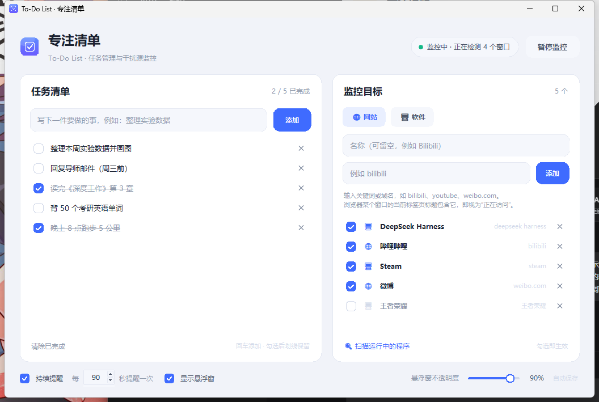
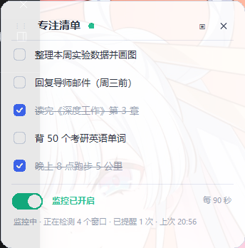
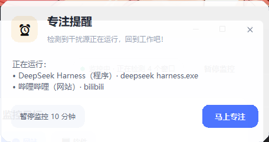
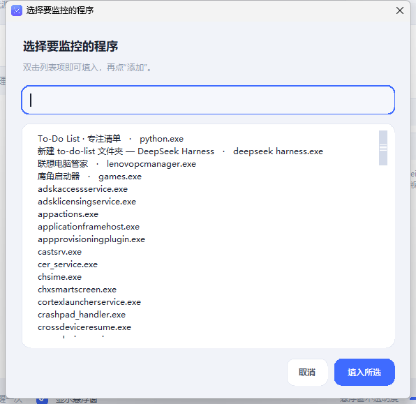

# To-Do List · 专注清单

一个 Windows 桌面小工具：左边管理今天的任务，右边盯住那些一打开就会让你分心的网站和软件。
开着监控时，一旦检测到你打开了它们，就会弹窗提醒你"回到工作"。

界面是白色圆角风格（卡片、输入框、按钮、勾选框都是圆角），主窗口负责编辑，另有一个像音乐播放器歌词窗口一样的置顶悬浮窗；提醒弹窗带半透明毛玻璃感。



## 直接使用

不想碰代码的话，去仓库的 **Releases** 页面下载打包好的文件，两种版本功能完全一样：

| 版本 | 下载文件 | 适合 |
| --- | --- | --- |
| **安装包**（推荐自己用） | `ToDoList-Setup-x.y.z.exe` | 双击安装，有开始菜单 / 桌面图标，可在"应用和功能"里卸载；装到 `%LOCALAPPDATA%\ToDoList`，不需要管理员权限 |
| **便携版** | `ToDoList-portable-x.y.z.zip` | 解压到一个文件夹里双击就用，不写注册表；放 U 盘里可以带走 |

仓库里**只放源码**，exe 打包产物走 Releases（体积原因，见 `.gitignore`）。想自己构建见下面的「重新打包」。

数据存放规则（两个版本一致）：

- 默认存在 **`%APPDATA%\ToDoList\todo.json`**（安装版就是这种）。
- 如果 exe 旁边有 `portable.txt` 文件（便携版自带），则改存在 **exe 同级的 `data\todo.json`**，跟着文件夹走。
- 万一目标目录不可写（比如放进 Program Files 又没有权限），程序会自动退到 `%LOCALAPPDATA%\ToDoList` → exe 同级 `data\` → 临时目录，不会悄悄丢数据。

首次从旧版本升级时，如果发现 exe 旁边有旧的 `data\todo.json`，会自动复制到新位置。

## 三个主要功能

### 1. 任务清单

- 在输入框写下一件事，按 **回车** 或点 **添加**。框里的灰色提示文字点进去就会消失，离开输入框又会回来。
- 点左侧方框 **勾选完成**：文字会划掉、变灰，但**不会消失**，方便回看今天做了什么。
- 点任务文字可以直接**改**；清空文字后按回车（或点到别处）等于删除这一条。
- 每行右侧的 **✕** 删除单条；左下角 **清除已完成** 一次性清掉所有划线任务。
- 顶部计数显示"已完成 / 总数"。

### 2. 监控目标

分两类，右侧切换：

| 类型 | 判定方式 | 例子 |
| --- | --- | --- |
| 网站 | 浏览器（Chrome / Edge / Firefox / Brave / Opera / 360 / QQ …）有**非最小化**窗口，且窗口标题包含关键词 | `bilibili`、`youtube`、`weibo.com`、`明日方舟` |
| 软件 | 进程名匹配，或窗口标题包含关键词 | `steam`、`msedge`、`游戏名` |

- 名称随便写（只是显示用），关键词填能唯一命中的片段即可。
- 输入框右边点 **扫描运行中的程序 / 选择网站**，可以从当前正在运行的进程、或者浏览器当前打开的标签页里直接挑一个，自动填好关键词。
- 每行前的方框可以临时**停用**某个目标，不用删掉。

### 3. 专注提醒

- 右上角 **开始监控** 后开始检测，状态栏会显示"监控中 · 正在检测 N 个窗口"。
- 一旦某个目标被打开，屏幕上方弹出提醒窗：写着是哪个目标、命中的是什么（程序名 / 窗口标题）。
- 提醒窗上的两个按钮：
  - **暂停监控 10 分钟**：临时闭嘴，适合"我现在就是要看十分钟视频"。
  - **马上专注**：关掉提醒，继续监控。
- 底部可以设置 **持续提醒** 与间隔（默认每 90 秒重复一次），也可以关掉，只在刚打开时提醒一次。
- 提醒窗是**半透明**的圆角卡片（不遮挡也能看清后面的内容），22 秒后自动消失，不会一直挡着屏幕。

### 4. 悬浮窗

类似歌词窗口的小条：白色圆角卡片、**半透明**、置顶、可以拖到屏幕任意角落。

- 显示**全部任务**，可以直接在悬浮窗里勾选完成。
- 底部有**监控开关**，不开主界面也能开关监控。
- `▣` 打开主界面，`✕` 隐藏悬浮窗，右键还有菜单（打开主界面 / 隐藏 / 退出）。
- 主界面底部可以随时勾回 **显示悬浮窗**，还能拖动 **悬浮窗不透明度** 滑块（40%–100%，默认 **90%**，滑杆右侧实时显示百分比）。
- 悬浮窗和主窗口共用同一份数据，改动实时同步。

## 界面预览

| 悬浮窗（监控中） | 专注提醒 |
| --- | --- |
|  |  |



## 一些细节

- **自动保存**：任何改动立刻写盘，关掉窗口再打开都在。
- **单实例**：重复双击 exe 不会开出第二个程序，而是把已经在跑的那个窗口叫到前面。
- **窗口位置记忆**：主窗口大小位置、悬浮窗位置都会记住。
- **退出程序**：点主窗口右上角的 ✕，或者在悬浮窗上右键 → 退出程序。悬浮窗上的 ✕ 只是把悬浮窗收起来。
- **只用 Windows 自带的窗口/进程查询接口**：不注入、不抓屏、不联网、不上传任何数据。

## 分发给别人

1. **发安装包**：把 Releases 里的 `ToDoList-Setup-1.1.0.exe`（约 10 MB）发过去，对方双击 → 下一步即可。
   安装时可以勾选"创建桌面快捷方式"和"开机自动启动"（不启动就不会监控，所以建议勾上）。
2. **发便携版**：发 `ToDoList-portable-1.1.0.zip`（约 12 MB），对方解压到任意可写目录，双击里面的 `ToDoList.exe`。

需要提前告诉对方两件事：

- **SmartScreen 提示**：程序没有购买代码签名证书，第一次运行 Windows 会显示"Windows 已保护你的电脑"，
  点 **更多信息 → 仍要运行** 即可。这不是报毒。
- **数据不会被卸载**：卸载安装包只删除程序目录，`%APPDATA%\ToDoList` 里的任务数据会保留。
  想彻底清干净，手动删掉那个文件夹。

> 只发 `ToDoList.exe` 这一个文件是跑不起来的，它依赖同级的 `_internal` 文件夹——发整个文件夹或压缩包。

## 目录结构

```
to-do-list/
├─ .github/workflows/tests.yml      GitHub Actions：Windows 上跑单元测试
├─ dist/                            构建产物（不进仓库，见 .gitignore）
│  ├─ ToDoList/ToDoList.exe         onedir 可执行目录
│  ├─ installer/                   ToDoList-Setup-1.1.0.exe 安装包
│  ├─ portable/ToDoList/           便携版目录（含 portable.txt）
│  └─ ToDoList-portable-1.1.0.zip  便携版压缩包
├─ installer/ToDoList.iss          Inno Setup 打包脚本
├─ app.py                          程序入口：装配窗口、线程、提醒、数据目录
├─ store.py                        数据读写（JSON + 变更通知）
├─ monitor.py                      进程/窗口枚举与"是否在运行"判定
├─ ui_main.py                      主窗口 + 选择程序对话框
├─ ui_float.py                     置顶悬浮窗
├─ ui_reminder.py                  专注提醒弹窗
├─ theme.py                        白色圆角主题、手绘控件（卡片 / 按钮 / 输入框 / 勾选框 / 开关）
├─ assets/icon.png、icon.ico       图标（png 给界面，ico 给 exe 和安装包）
├─ screenshots/                    界面截图
├─ tests/test_core.py              核心逻辑单元测试（15 个用例）
├─ run.bat                         从源码启动（pythonw，无黑框）
├─ LICENSE                         MIT
└─ data/todo.json                  从源码运行时的数据文件
```

## 从源码运行

需要 Windows + Python 3.10 以上（自带 tkinter 即可，无需第三方库）：

```
python app.py
```

或者双击 `run.bat`（用 pythonw 启动，不弹黑框）。

## 测试

```
python -m unittest discover -s tests -t .
```

## 重新打包

```
python -m PyInstaller --noconfirm --clean ToDoList.spec
"C:\Users\<你>\AppData\Local\Programs\Inno Setup 6\ISCC.exe" installer\ToDoList.iss
```

第一条生成 `dist\ToDoList\`（onedir，比 onefile 稳，不需要解压临时目录）；
第二条把它压成安装包。便携版压缩包就是 `dist\ToDoList\` 加一个 `portable.txt` 再压成 zip。

## 已知限制

- 网站是**靠浏览器窗口标题**判断的：切标签页时标题可能滞后一两秒；全屏视频、某些内置浏览器（如微信/QQ 内置页）不含关键词时不会触发。
- 只有检测到"窗口可见且没被最小化"才算在用，最小化后不再提醒。
- 提醒是应用自己的置顶窗口，不走系统通知，所以不会被 Windows 专注助手折叠，但也不会出现在通知中心里。
- 程序没签名，第一次运行会被 SmartScreen 拦一次；要彻底消掉需要买代码签名证书。
- 开机自启只能在安装时勾选（写 HKCU 的 Run 键），便携版没有这个开关。

## 许可证

[MIT](LICENSE) © 2026 chenmu

用着顺手就点个 ⭐，有想法或 bug 欢迎开 Issue。
